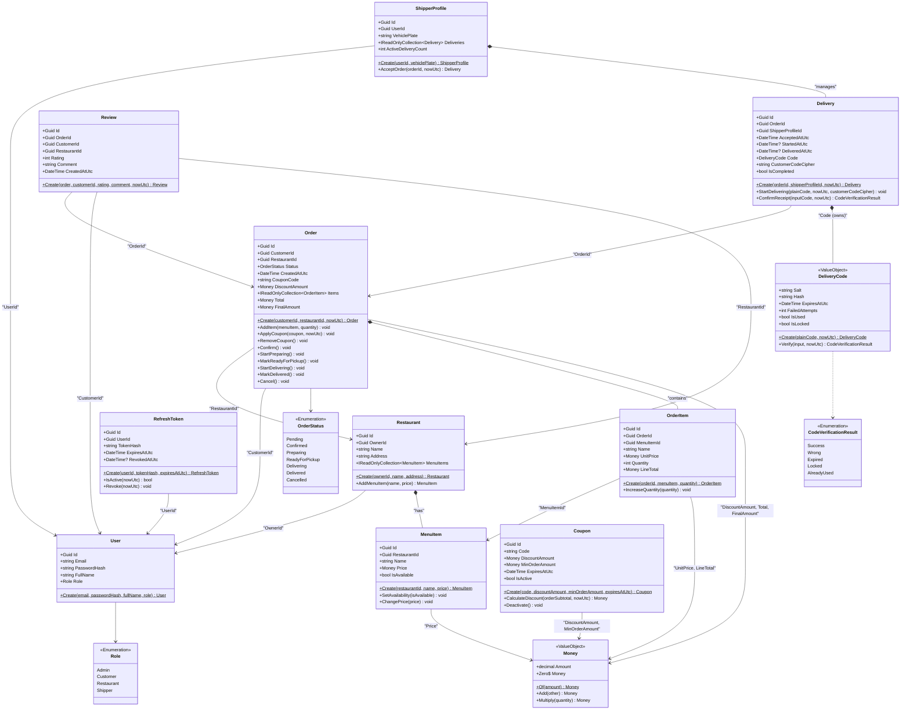

# Sơ đồ lớp tầng Domain (Domain Class Diagram)

Sơ đồ thể hiện các thực thể (Entity), đối tượng giá trị (Value Object), kiểu liệt kê (Enum) và quy tắc quan hệ trong tầng `FoodHub.Domain`. Tầng Domain độc lập hoàn toàn, không phụ thuộc vào bất kỳ tầng nào khác.

